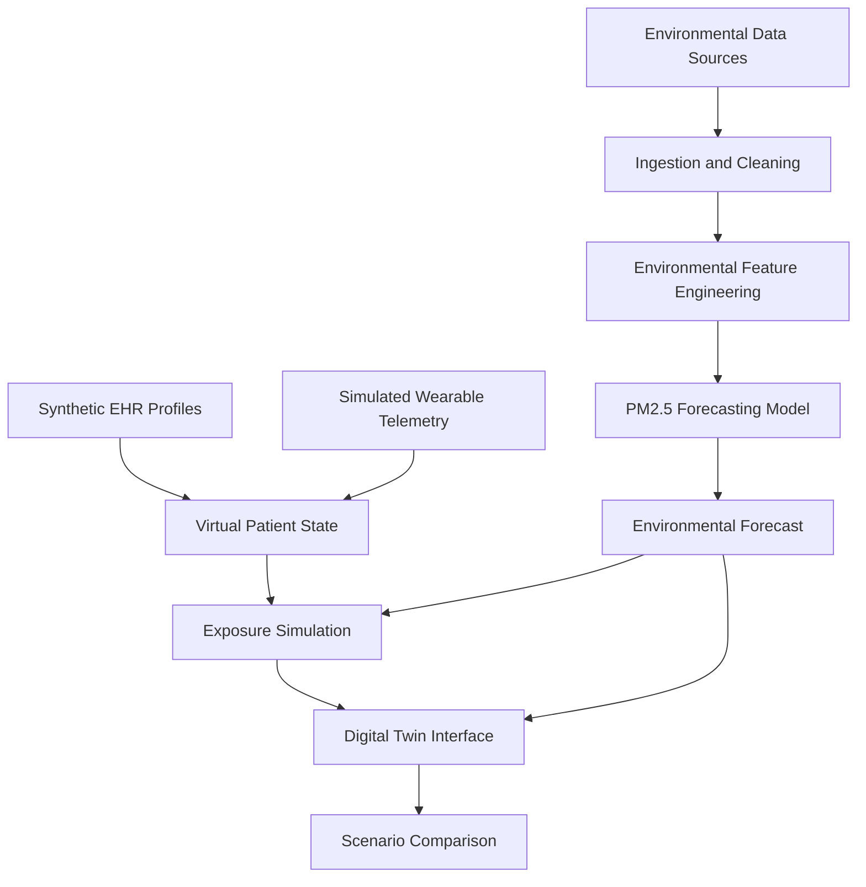

# 🌍 AeroTwin
### Environmental Intelligence & In-Silico Cardiorespiratory Digital Twin

**Predict the environment. Personalize exposure. Simulate the patient's future.**

AeroTwin is a research-oriented digital health prototype that connects environmental intelligence with a virtual cardiorespiratory patient. By combining air-quality observations, atmospheric forecasts, synthetic electronic health records (EHRs), and simulated wearable telemetry, AeroTwin explores how environmental exposure and individual susceptibility can support more proactive health-risk monitoring.

Rather than treating air pollution as a city-wide number, AeroTwin models a patient's potential exposure across indoor, transit, and outdoor environments and provides an interactive interface for exploring personalized mitigation scenarios.

<p align="center">
  
  
  
  
</p>

<p align="center">
  <b>Built by Binary Mind</b><br/>
  ABES Engineering College, Ghaziabad, India<br/>
  Happiest Health — Reimagining and Reforming Healthcare in India Summit 2026
</p>

---

## 🩺 1. The Problem: Air Quality Is Personal

Air pollution is not just an environmental problem. Exposure to fine particulate matter and other pollutants is associated with adverse respiratory and cardiovascular outcomes, particularly among susceptible individuals.

Yet a city-level Air Quality Index (AQI) cannot fully represent an individual's daily exposure or physiological context.

Two people living in the same city may experience very different exposure patterns because of their routines, indoor environments, commuting conditions, and underlying health characteristics.

**The challenge:** How can environmental data and patient-specific information be brought together to explore personalized, proactive health monitoring?

### Where existing monitoring falls short

- **Population-level measurements:** City-wide readings do not represent every person's micro-environment.
- **Missing clinical context:** The same environmental conditions may affect people differently depending on their health history.
- **Disconnected data streams:** Environmental observations, clinical records, and wearable signals are often analyzed separately.
- **Limited scenario exploration:** People need ways to understand how possible exposure-reduction measures could change their estimated exposure.

### Our approach

AeroTwin brings these data streams into one experimental framework, maintaining a virtual representation of a patient's environmental and physiological context.

> **From monitoring polluted air to modeling how exposure may affect an individual.**

---

## 🚀 2. What Is AeroTwin?

AeroTwin is a multimodal environmental intelligence and cardiorespiratory Digital Twin proof of concept.

It combines three complementary layers:

| Layer | Data | Purpose |
|---|---|---|
| Environmental intelligence | PM2.5, PM10, available pollutant measurements, AQI and weather | Characterize current conditions and forecast PM2.5 |
| Virtual patient / EHR | Age, BMI, asthma history, hypertension and other synthetic patient characteristics | Represent baseline susceptibility |
| Dynamic physiological state | Simulated heart rate, HRV, SpO₂, sleep and activity | Represent changing physiological context |

These inputs feed two distinct computational components:

1. **Environmental forecasting engine:** Estimates next-day PM2.5 concentration using historical pollutant patterns and temporal features.
2. **Patient exposure and twin simulation engine:** Estimates time-weighted exposure under configurable environmental scenarios and presents a simulated patient state.

The dashboard brings these components together so a user can inspect the environmental forecast, review a virtual patient's context, and explore possible exposure-reduction strategies.

**Important distinction:** Forecasting pollution is a measurable modeling task. Estimating future clinical events requires a separately validated health-outcome model. AeroTwin's clinical-risk outputs must be described according to the actual implementation and available evidence.

---

## 🎯 3. Healthcare Use Case

### Primary use case: Personalized environmental exposure assessment

Consider a fictional patient living in a highly polluted urban area who has a history of asthma and hypertension.

The patient's day includes time indoors, a daily commute, and outdoor activity. The environmental forecast indicates that PM2.5 may rise the following day.

AeroTwin allows the user to explore questions such as:

- How might the patient's estimated daily exposure change if indoor filtration were available?
- How would a different commute duration affect the modeled exposure?
- How do baseline health characteristics and simulated physiological measurements change the context shown by the virtual patient?
- What does the environmental forecast indicate for the next 24 hours?

### Example scenario

**Illustrative values only — not an actual patient or validated clinical prediction.**

| Parameter | Example state |
|---|---|
| Patient profile | Synthetic adult with asthma history |
| Environmental context | Elevated forecast PM2.5 |
| Daily routine | Indoor time, transit and outdoor activity |
| Wearable context | Simulated HR, HRV, SpO₂ and sleep |
| Simulation | Compare baseline exposure with a mitigation scenario |
| Output | Estimated exposure difference and updated virtual-patient context |

The aim is to support exploration and awareness, not to diagnose an individual or prescribe treatment.

---

## ✨ 4. Key Features

### 🌫️ Environmental Intelligence

- Environmental pollutant data ingestion and processing.
- PM2.5 forecasting using historical measurements and temporal features.
- Air-quality trends and interactive visualizations.
- Weather context where source data is available.
- A foundation for location-aware environmental monitoring.

### 🫁 Cardiorespiratory Digital Twin

- Synthetic patient profiles and baseline health characteristics.
- A virtual representation of environmental and physiological context.
- Support for simulated dynamic wearable measurements.
- A patient-focused interface separate from the environmental overview.
- A foundation for testing future patient-specific health models.

### 🧪 What-If Exposure Simulation

Explore how changes to daily routines and protective measures may alter estimated exposure.

- Indoor filtration scenarios.
- Commuting-duration adjustments.
- Mask-filtration assumptions.
- Indoor, transit and outdoor time allocation.

### 📈 Explainable Environmental Forecasting

- Historical and lagged pollutant features.
- Rolling-window statistics and temporal features.
- Chronological holdout evaluation.
- Reported regression metrics and AQI category agreement.

### 🔐 Privacy-Conscious Development

- Synthetic patient profiles for demonstrations.
- No real patient-identifiable health information intended for inclusion.
- Separation of environmental data and synthetic health data.
- A research-oriented prototype with explicit limitations.

---

## 🧠 5. Machine Learning & Model Evaluation

### Primary prediction task

**Target:** Next-day PM2.5 concentration, measured in micrograms per cubic metre (µg/m³).

This is an environmental forecasting target, not a direct prediction of a cardiac event, asthma attack, or other clinical outcome.

### Feature engineering

The proposed feature pipeline uses available historical pollutant observations and time-derived variables, including:

- Lagged PM2.5 and PM10 concentrations.
- Available NO2, CO and SO2 measurements.
- AQI, where its definition and availability are consistent with the dataset.
- Rolling 24-hour statistics.
- Pollutant rate-of-change features.
- Seasonal and calendar-derived features.

Features must be constructed using information available at the forecast origin. Missing data and source-specific availability should be documented.

### Model pipeline

```text
Environmental observations
          ↓
Data cleaning and validation
          ↓
Chronological feature engineering
          ↓
Training / holdout split
          ↓
Gradient-boosted regression model
          ↓
Next-day PM2.5 forecast
          ↓
Evaluation and dashboard visualization
```

### Reported evaluation results

The following values are reported in the current project specification and should be verified against the saved evaluation output before final submission.

| Metric | Reported value | Interpretation |
|---|---:|---|
| R² | 0.8140 | Variance explained on the stated holdout |
| MAE | 12.15 µg/m³ | Mean absolute prediction error |
| RMSE | 20.34 µg/m³ | Root mean squared prediction error |
| CPCB category agreement | 84.2% | Reported agreement with air-quality categories |

**Validation approach:** Chronological held-out evaluation intended to avoid temporal data leakage.

For a reproducible evaluation, document the dataset period, geographical coverage, split dates, baseline comparison, model configuration, feature availability, and evaluation script. Reported metrics should not be interpreted as proof of clinical accuracy or performance across every Indian city.

### Digital Twin modeling

The patient simulation component combines:

- Baseline characteristics from synthetic EHR profiles.
- Time-varying environmental conditions.
- Simulated physiological signals.
- Time allocation across different micro-environments.
- Configurable filtration and exposure-reduction assumptions.

Any clinical-risk score should be labeled as simulated or experimental unless a defined health-outcome model has been trained and independently evaluated using appropriate data.

---

## 🧮 6. Exposure Simulation Engine

AeroTwin uses a time-weighted exposure calculation to explore how daily routines and mitigation assumptions influence modeled PM2.5 exposure.

Let:

- \(T_i\) = hours spent indoors.
- \(T_t\) = hours spent in transit.
- \(T_o\) = hours spent outdoors.
- \(C_i, C_t, C_o\) = relevant PM2.5 concentrations in those environments.
- \(\eta_p\) = assumed purifier removal efficiency.
- \(\eta_m\) = assumed mask filtration efficiency.

A simplified model is:

\[
C_{\mathrm{weighted}} =
\frac{
T_i C_i(1-\eta_p)
+
T_t C_t(1-\eta_m)
+
T_o C_o
}{24}
\]

subject to:

\[
T_i+T_t+T_o=24
\]

The result is an estimated time-weighted concentration, expressed in µg/m³.

If all three environments are assumed to have the same ambient concentration, the model can be simplified. However, indoor concentrations should not automatically be assumed equal to outdoor concentrations in a real exposure study.

### What-if workflow

1. Select a synthetic patient profile.
2. Review the environmental forecast.
3. Configure indoor, transit and outdoor time.
4. Adjust assumed filtration efficiencies.
5. Compare baseline and intervention-scenario exposure estimates.
6. Inspect the difference in the dashboard.

**Model limitation:** This is a simplified exposure model, not a direct measurement of inhaled or deposited particulate mass. Actual exposure depends on indoor infiltration, ventilation, mask fit, breathing rate, activity, pollutant composition and other factors. The simulation should not be presented as proof that a particular intervention reduces clinical risk by a specific percentage.

---

## 🏗️ 7. System Architecture



### Architecture overview

| Component | Responsibility |
|---|---|
| Data ingestion | Load environmental observations and supported external data |
| Cleaning pipeline | Validate, normalize and process source data |
| Forecasting model | Generate next-day PM2.5 estimates |
| Twin engine | Represent the synthetic patient's baseline and changing state |
| Exposure simulator | Compare baseline and alternative exposure assumptions |
| Flask application | Serve the dashboard and application endpoints |
| Interactive UI | Present environmental intelligence and patient-twin views |

The environmental forecasting model and patient simulation are separate components. This separation supports testing, clearer scientific interpretation and future integration of independently validated health-outcome models.

---

## 🖥️ 8. Application Interface

AeroTwin provides two main application views:

### Environmental Intelligence

Route: `/`

Designed to present environmental data, trends, model outputs and the data-processing context.

### Patient Digital Twin

Route: `/twin`

Designed to present the synthetic patient's baseline profile, physiological context and exposure-simulation workflow.

### Screenshots

Replace the placeholders below with screenshots captured from the running application before submitting the repository.

| Environmental Intelligence | Patient Digital Twin |
|---|---|
| Add screenshot of the environmental dashboard | Add screenshot of the patient twin |
| Show pollutant trends and forecast | Show patient profile and twin state |

Suggested repository location:

```text
docs/
└── screenshots/
    ├── environmental-dashboard.png
    └── patient-digital-twin.png
```

Use relative image paths in this README after adding the screenshots.

---

## 🛠️ 9. Technology Stack

| Layer | Technologies |
|---|---|
| Language | Python 3 |
| Web framework | Flask |
| Data processing | Pandas, NumPy |
| Machine learning | Scikit-learn, gradient-boosted regression trees |
| Model persistence | Joblib |
| Visualization | Plotly.js |
| Frontend | HTML, CSS, JavaScript |
| Typography | Inter, JetBrains Mono |
| Testing | Python `unittest` |
| Environmental data | CPCB sources and Open-Meteo, subject to endpoint availability and data provenance |

### Interface design

AeroTwin uses an Obsidian Dark Cyber-Clinical visual direction:

- Canvas: `#070A0D`
- Surface: `#0D1217`
- Accent: `#10B981`

The design emphasizes contrast, readable metrics, environmental trends and a focused clinical interface.

---

## 📂 10. Repository Structure

```text
AeroTwin/
├── app/
│   ├── app.py
│   └── templates/
│       ├── index.html
│       └── twin.html
├── cleaning/
│   └── clean_data.py
├── data/
│   ├── healthcare/
│   ├── processed/
│   └── raw/
├── model/
│   ├── train.py
│   ├── predict.py
│   ├── evaluate.py
│   ├── simulation.py
│   ├── realtime_service.py
│   ├── artifacts/
│   └── healthcare/
├── tests/
│   ├── test_step8_dashboard.py
│   ├── test_healthcare_twin.py
│   └── test_csv_upload.py
├── requirements.txt
├── RUN_GUIDE.md
├── README.md
└── LICENSE
```

### Key modules

- `cleaning/clean_data.py` — environmental-data ingestion and preprocessing.
- `model/train.py` — environmental forecasting model training.
- `model/predict.py` — inference utilities.
- `model/evaluate.py` — evaluation metrics.
- `model/simulation.py` — exposure scenario calculations.
- `model/realtime_service.py` — telemetry synchronization, subject to the implemented data source and refresh mechanism.
- `model/healthcare/` — patient-twin modeling components.
- `app/app.py` — Flask application and routes.
- `tests/` — dashboard, data-ingestion and twin tests.

---

## ⚙️ 11. Installation and Execution

### Prerequisites

- Python 3 installed.
- Git installed.
- PowerShell on Windows, or a compatible terminal on Linux/macOS.
- Network access if live external data sources are enabled.

### Step 1 — Clone the repository

```bash
git clone https://github.com/srivastavanandani190-lang/AeroTwin.git
cd AeroTwin
```

### Step 2 — Create a virtual environment

Windows PowerShell:

```powershell
python -m venv venv
.\venv\Scripts\Activate.ps1
```

Linux/macOS:

```bash
python3 -m venv venv
source venv/bin/activate
```

### Step 3 — Install dependencies

```bash
python -m pip install --upgrade pip
pip install -r requirements.txt
```

### Step 4 — Run the tests

The project specification reports 34 tests across the three listed test modules. Confirm the current test count and results in the repository before claiming that all tests pass.

```bash
python -m unittest tests/test_csv_upload.py tests/test_step8_dashboard.py tests/test_healthcare_twin.py
```

### Step 5 — Launch AeroTwin

```bash
python app/app.py
```

Open the following local URLs:

- Environmental Intelligence: http://127.0.0.1:5000/
- Patient Digital Twin: http://127.0.0.1:5000/twin

For troubleshooting, refer to [`RUN_GUIDE.md`](RUN_GUIDE.md).

---

## 🌐 12. Data Sources and Data Governance

AeroTwin is designed to use environmental observations and synthetic health data.

### Environmental data

- **CPCB:** Central Pollution Control Board air-quality monitoring resources. Data availability, station coverage, historical access and permitted usage must be verified for the selected source.
- **Open-Meteo Air Quality API:** Environmental pollutant and forecast information where supported by the selected endpoint.
- **Weather data:** Used where available to provide additional atmospheric context.

### Synthetic healthcare data

Patient characteristics and physiological streams are intended for prototype demonstration and must be identified as synthetic or simulated wherever applicable.

The project should not imply that synthetic profiles represent real patients or that model outputs have been clinically validated.

### Privacy principles

- Do not commit real patient-identifiable information.
- Avoid publishing API credentials or secrets.
- Document dataset provenance and licenses.
- Separate observed measurements from synthetic values and generated predictions.
- Respect source-specific access and attribution requirements.

---

## 🧪 13. Testing and Reproducibility

AeroTwin includes test modules for dashboard integration, patient-twin logic and CSV ingestion.

Before the final submission, verify:

- Data ingestion handles missing and malformed observations.
- Time-based features do not use future information.
- Forecast evaluation uses a chronological holdout.
- Exposure-simulation inputs satisfy the 24-hour time constraint.
- The patient-twin interface distinguishes observed, synthetic and predicted values.
- External-data failures are handled clearly.
- Model artifacts can be loaded using the documented environment.
- Reported metrics match the saved evaluation results.

Where possible, include a small synthetic sample dataset and a reproducible evaluation report so reviewers can inspect the workflow without requiring access to restricted patient data.

---

## 🩺 14. Clinical Safety and Limitations

AeroTwin is an engineering prototype for research, education and demonstration.

It is **not a validated medical diagnostic or treatment device**.

Current limitations include:

1. Environmental forecasts may be affected by station coverage, missing observations, weather conditions and geographic differences.
2. City-level measurements cannot establish a person's true personal exposure.
3. Simulated wearable signals are not equivalent to measurements from calibrated medical devices.
4. A virtual patient profile does not establish a clinically validated relationship between pollution exposure and an individual health event.
5. Exposure reductions in what-if scenarios depend on model assumptions and do not automatically imply proportional reductions in clinical risk.
6. Any future clinical-risk model requires a clearly defined outcome, appropriate labeled data, temporal validation, calibration, subgroup evaluation and independent clinical review.

AeroTwin must not be used to make clinical decisions or replace professional medical care.

---

## 🗺️ 15. Future Roadmap

### Phase 1 — Environmental intelligence
- Improve source provenance and data-quality reporting.
- Expand pollutant trend and forecasting evaluation.
- Add reproducible environmental data ingestion.

### Phase 2 — Dynamic patient twin
- Integrate clearly labeled synthetic wearable streams.
- Implement time-stamped patient-state updates.
- Display environmental and physiological histories together.

### Phase 3 — Personalized exposure simulation
- Add configurable micro-environment schedules.
- Improve indoor infiltration and filtration assumptions.
- Compare exposure scenarios with transparent model limitations.

### Phase 4 — Clinical research validation
- Define a specific cardiorespiratory outcome.
- Identify a suitable, licensed, appropriately labeled dataset.
- Train and validate a separate health-outcome model.
- Assess calibration, temporal generalization and subgroup performance before making clinical-risk claims.

### Long-term vision

AeroTwin aims to explore how environmental forecasting, patient-specific context and dynamic health signals could support a more proactive model of environmental health monitoring.

---

## 🏆 16. Alignment With the Digital Twin Challenge

| Challenge requirement | AeroTwin approach |
|---|---|
| Static/historical health data | Synthetic EHR patient profiles |
| Dynamic data stream | Simulated wearable telemetry, where implemented |
| Environmental intelligence | Air-quality observations and PM2.5 forecasting |
| Localized healthcare problem | Pollution-associated cardiorespiratory vulnerability |
| Working algorithmic model | Environmental forecasting and exposure simulation |
| Conceptual doctor interface | Patient Digital Twin dashboard |
| Privacy-conscious data | Synthetic patient data |
| Reproducible submission | Source code, setup guide, tests and evaluation artifacts |

**Scope clarification:** The current documented ML target is next-day PM2.5. A validated prediction of an adverse clinical event remains a separate development and evaluation milestone unless that capability is implemented and supported by evidence.

---

## 🎥 17. Hackathon Demo Journey

The demonstration should tell one connected story rather than simply navigate through charts.

1. **The environmental problem:** Show how city-level pollution readings fail to capture individual exposure.
2. **Meet the virtual patient:** Introduce a synthetic patient with a defined baseline health profile.
3. **Connect the environment:** Display the selected environmental observations and next-day PM2.5 forecast.
4. **Update the twin:** Show the patient's time-stamped, simulated physiological context.
5. **Run the exposure simulation:** Compare a baseline daily routine with an alternative mitigation scenario.
6. **Explain the output:** Identify which inputs and assumptions changed the modeled exposure.
7. **Discuss validation:** Present actual model metrics, testing results, data provenance and limitations.
8. **Show the next milestone:** Explain how a separately validated clinical-outcome model could extend the prototype.

The central message for the judges:

> **AeroTwin connects environmental intelligence with a personalized virtual patient, enabling users to explore how pollution exposure and mitigation assumptions shape a patient's modeled health context.**

---

## 👥 18. Team

**Team Name:** Binary Mind

**Institution:** ABES Engineering College, Ghaziabad, Uttar Pradesh, India

| Team member | Role |
|---|---|
| Parth Singh | Team Leader |
| Nandani Kumari | Team Member |

**Incubator:** Not applicable / N/A

---

## 📜 19. License

AeroTwin is intended to be released under the MIT License.

See [`LICENSE`](LICENSE) for the complete license text. Ensure the repository includes that file and that the selected licenses for datasets, dependencies and third-party assets are respected.

---

## 💬 Final Note

AeroTwin is an exploration of a more personalized approach to environmental health intelligence: combining the changing world around a patient with a virtual representation of that patient's health context.

**The vision is simple: don't just forecast the air. Model the patient's exposure to it.**

Built with Python, machine learning, environmental data and a commitment to transparent, privacy-conscious digital health research.

