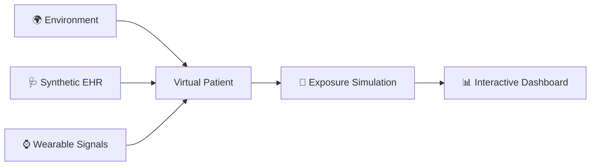
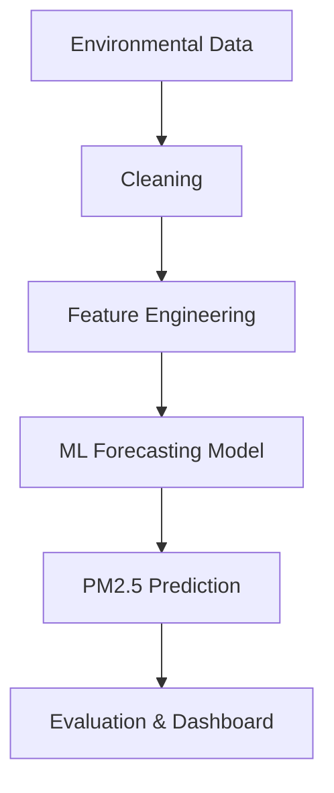
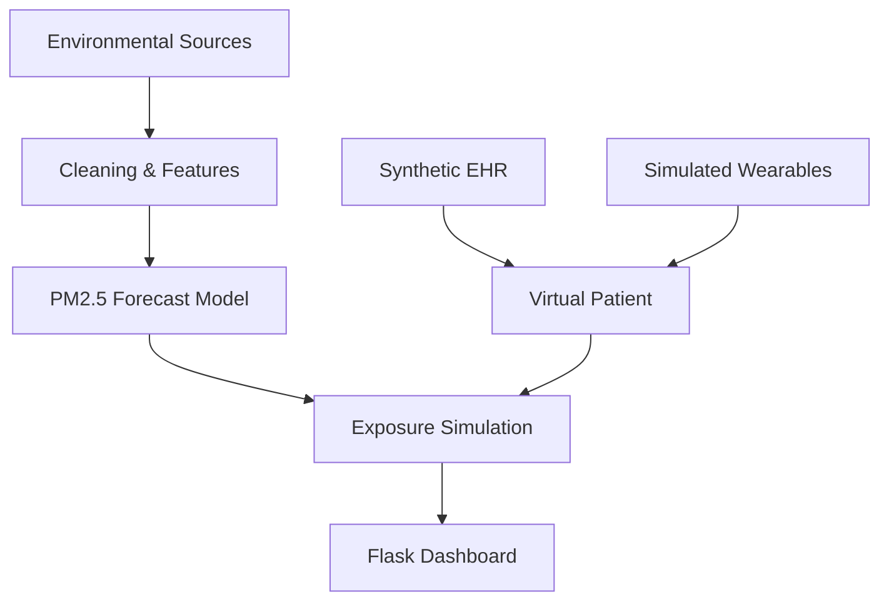

<div align="center">


# 🌍 AeroTwin

### Forecast the Air. Understand the Exposure. Explore the Patient Twin.

**AeroTwin** combines environmental intelligence, synthetic patient records, and simulated wearable signals to explore personalized environmental exposure.

**Binary Mind** | ABES Engineering College, Ghaziabad  
*Happiest Health Summit 2026 · Bengaluru*

[](#)
[](#)
[](#)
[](#)

</div>

---

## ✨ 01. Team Details

| Field | Details |
|---|---|
| Team Name | Binary Mind |
| Team Leader | Parth Singh |
| Team Member | Nandani Kumari |
| College | ABES Engineering College, Ghaziabad |
| Incubator | N/A |
| Leader Phone | |
| Leader Email | |

## 🏛️ 02. College / Incubator Information

- **Institution:** ABES Engineering College
- **Location:** Ghaziabad, Uttar Pradesh, India
- **Incubator:** N/A
- **Institution / Incubator URL:** 

## 🚀 03. Project Title

# AeroTwin
### Multimodal Environmental Intelligence & In-Silico Cardiorespiratory Digital Twin

> What if we could connect the air around a person with a virtual representation of their health context?

## 🩺 04. Problem Statement

City-level AQI cannot fully represent an individual's exposure across indoor, transit, and outdoor environments.

AeroTwin explores this gap by connecting:

- 🌫️ Environmental pollutant observations and PM2.5 forecasting
- 🧬 Synthetic EHR profiles and baseline susceptibility
- ⌚ Simulated wearable signals such as HR, HRV, SpO₂, sleep, and activity

**Goal:** Explore personalized exposure scenarios through a virtual cardiorespiratory patient.

## 🫀 05. Healthcare Use Case

A fictional urban patient has a history of asthma and experiences elevated pollution exposure.

AeroTwin lets users:

1. Select a synthetic patient profile.
2. Review environmental observations and the PM2.5 forecast.
3. Inspect simulated wearable measurements.
4. Compare baseline exposure with a what-if scenario.
5. Explore how indoor filtration or commute changes affect estimated exposure.

### 🔬 The Digital Twin Workflow



⚠️ *Research prototype only. Environmental forecasting and exposure simulation are not equivalent to clinically validated prediction of a health event.*

## 🛠️ 06. Technical Stack

| Component | Technology |
|---|---|
| Backend | Python, Flask |
| Data Processing | Pandas, NumPy |
| ML Framework | Scikit-learn |
| Model | Gradient-boosted regression trees |
| Model Persistence | Joblib |
| Visualization | Plotly.js |
| Frontend | HTML, CSS, JavaScript |
| Testing | Python unittest |

## 🤖 07. AI/ML Model Details

**Prediction target:** Next-day PM2.5 concentration (µg/m³).



### 📈 Reported Model Results

| Metric | Result |
|---|---:|
| R² | 0.8140 |
| MAE | 12.15 µg/m³ |
| RMSE | 20.34 µg/m³ |
| CPCB Category Agreement | 84.2% |

*Verify these reported values against your saved evaluation artifacts before submission. They measure environmental forecasting, not clinical-event prediction.*

### Exposure Simulation

A simplified time-weighted concentration estimate:

\[
C_{\text{weighted}} =
\frac{T_iC_i(1-\eta_p)+T_tC_t(1-\eta_m)+T_oC_o}{24}
\]

The estimate depends on time spent indoors, in transit, and outdoors, along with assumed filtration efficiencies.

## 🎥 08. Demo Video — 15–20 Minutes

**Unlisted YouTube Link:** 

Include a demonstration of:
- Project introduction and problem statement
- Data pipeline and ML model
- Synthetic patient profile
- Simulated wearable telemetry
- Exposure what-if simulation
- Dashboard, evaluation, and limitations

## 📜 09. Open-Source License

**License:** MIT License

**License file:** [`LICENSE`](LICENSE)

**Dataset / third-party attribution:** 

## 🏗️ 10. Architecture Diagram — PDF/PPT

**File:** [(https://drive.google.com/file/d/1QuxBUBn6p15cPnuSeRJMI1-GbPNIy4a-/view?usp=sharing))



## 📊 11. Project Presentation — PDF/PPT

**Presentation:** [(https://drive.google.com/file/d/1-OyiInABxXCl2irEZzMwDmQzYg1rVU4h/view?usp=sharing))

**Suggested coverage:** Problem → Solution → Data → Architecture → ML Model → Results → Live Demo → Impact → Limitations.

---

## 🖥️ Run AeroTwin Locally

```bash
git clone https://github.com/srivastavanandani190-lang/AeroTwin.git
cd AeroTwin
python -m venv venv
```

**Windows PowerShell**

```powershell
.\venv\Scripts\Activate.ps1
pip install -r requirements.txt
python app/app.py
```

**Open the application:**

- Dashboard: http://127.0.0.1:5000/
- Patient Twin: http://127.0.0.1:5000/twin

## 📡 Data Sources

- **CPCB:** Central Pollution Control Board air-quality resources
- **Open-Meteo:** [Air Quality API](https://air-quality-api.open-meteo.com/v1/air-quality)
- **Synthetic EHR source:** 
- **Wearable dataset / simulator:** 
- **Dataset license and attribution:** 

## 🗂️ Project Structure

```text
AeroTwin/
├── app/
│   ├── app.py
│   └── templates/
├── cleaning/
├── data/
│   ├── raw/
│   ├── processed/
│   └── healthcare/
├── model/
│   ├── train.py
│   ├── predict.py
│   ├── evaluate.py
│   ├── simulation.py
│   ├── realtime_service.py
│   ├── artifacts/
│   └── healthcare/
├── tests/
├── docs/
├── requirements.txt
├── RUN_GUIDE.md
├── LICENSE
└── README.md
```

## ⚠️ Limitations & Privacy

- Use synthetic or appropriately licensed health data.
- Do not publish identifiable patient information or API secrets.
- Wearable signals may be simulated rather than measured from real devices.
- Exposure estimates depend on modeling assumptions.
- Clinical-event prediction requires a separately developed and validated outcome model.

## ✅ Hackathon Submission Checklist

- [x] Team details
- [x] College / incubator information
- [x] Project title
- [x] Problem statement
- [x] Healthcare use case
- [x] Technical stack
- [x] AI/ML model details
- [ ] Unlisted 15–20 minute demo video
- [ ] MIT License file
- [ ] Architecture diagram PDF/PPT
- [ ] Project presentation PDF/PPT
- [ ] All files and links publicly accessible

---

<div align="center">

### 🧡 Model the Exposure. Make the Invisible Visible.

**Built by Binary Mind | ABES Engineering College, Ghaziabad**


</div>
