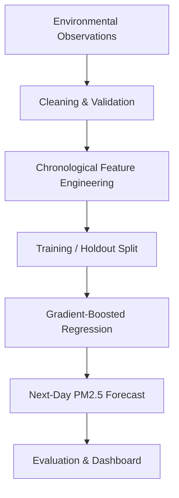
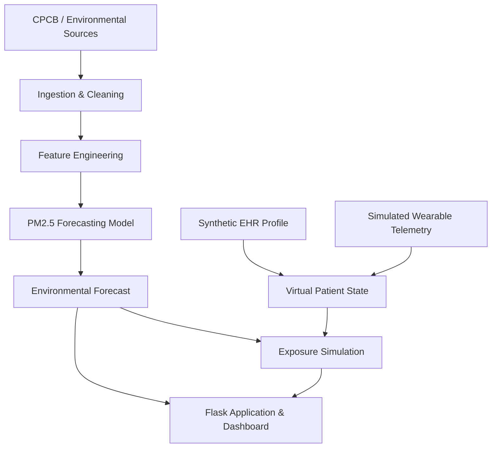

<div align="center">

# 🌍 AeroTwin
### Multimodal Environmental Intelligence & In-Silico Cardiorespiratory Digital Twin

**Forecast the environment. Model personal exposure. Explore a more proactive future for health.**

AeroTwin is a research-oriented Digital Twin proof of concept that brings together environmental observations, synthetic patient records, and simulated wearable telemetry to explore personalized cardiorespiratory exposure scenarios.

<br/>


**Happiest Health — Reimagining and Reforming Healthcare in India Summit 2026**

**Team:** Binary Mind · **Institution:** ABES Engineering College, Ghaziabad, India

</div>

---

## 1. 👥 Team Details

| Field | Details |
|---|---|
| Team Name | **Binary Mind** |
| Team Leader | Parth Singh |
| Team Members | Parth Singh — Team Leader; Nandani Kumari — Team Member |
| College | ABES Engineering College, Ghaziabad |
| Incubator | N/A |
| Team Leader Contact Number | |
| Team Leader Email | |

---

## 2. 🏷️ College / Incubator Information

| Field | Details |
|---|---|
| College / Institution | ABES Engineering College |
| Location | Ghaziabad, Uttar Pradesh, India |
| Incubator Name | N/A |
| Incubator / Institution Details URL | |
| Department / Program | |
| Faculty Mentor (if applicable) | |

---

## 3. 🚀 Project Title

# AeroTwin: Multimodal Environmental Intelligence & In-Silico Cardiorespiratory Digital Twin

**One-line pitch:** AeroTwin combines air-quality intelligence, synthetic EHR profiles, and simulated wearable signals to explore how environmental exposure and individual susceptibility can be represented in a virtual cardiorespiratory patient.

---

## 4. 🩺 Problem Statement

Ambient air pollution—especially fine particulate matter such as PM2.5 and PM10—is associated with adverse respiratory and cardiovascular health outcomes. However, city-level air-quality readings cannot fully describe an individual's exposure throughout the day or their underlying health context.

### The problem

- **Population averages:** A city-level AQI does not capture every person's indoor, transit, and outdoor exposure.
- **Different susceptibility:** Age, BMI, asthma history, hypertension, and other factors can influence individual health context.
- **Disconnected data:** Environmental measurements, clinical history, and wearable signals are often examined separately.
- **Limited scenario exploration:** People need understandable ways to compare possible exposure-reduction scenarios.

### Our approach

AeroTwin connects environmental intelligence with a synthetic virtual patient and a configurable exposure-simulation engine. It is designed to help users explore environmental conditions, patient context, and modeled exposure scenarios through one interface.

> **From monitoring the air around a city to exploring the exposure context of a virtual patient.**

---

## 5. 🏥 Healthcare Use Case

### Personalized environmental exposure assessment

AeroTwin focuses on a synthetic urban patient with a cardiorespiratory susceptibility profile, such as a history of asthma or hypertension. The prototype combines environmental conditions with patient characteristics and simulated physiological measurements.

**Example workflow**

1. Select a synthetic patient profile.
2. Review available environmental observations and the next-day PM2.5 forecast.
3. Inspect the patient's simulated wearable context, such as heart rate, HRV, SpO₂, sleep, and activity.
4. Configure indoor, transit, and outdoor time assumptions.
5. Compare a baseline exposure estimate with an alternative scenario, such as indoor filtration or a changed commute.
6. Review the modeled exposure difference and the assumptions behind it.

### Data streams

| Stream | Example fields | Role |
|---|---|---|
| Environmental | PM2.5, PM10, available NO2/CO/SO2, AQI, weather | Environmental monitoring and forecasting |
| Static / historical EHR | Age, BMI, asthma history, hypertension and other synthetic profile fields | Baseline patient context |
| Dynamic wearable telemetry | Heart rate, HRV, SpO₂, sleep and activity | Simulated changing physiological context |

### Exposure simulation

A simplified time-weighted concentration estimate can be expressed as:

\[
C_{\mathrm{weighted}} =
\frac{
T_i C_i(1-\eta_p)+
T_t C_t(1-\eta_m)+
T_o C_o
}{24}
\]

Where \(T_i,T_t,T_o\) are hours spent indoors, in transit, and outdoors; \(C_i,C_t,C_o\) are the corresponding PM2.5 concentrations; and \(\eta_p,\eta_m\) are assumed purifier and mask filtration efficiencies. The time allocation should sum to 24 hours.

This is a simplified exposure estimate—not a direct measurement of inhaled or deposited particulate mass, nor proof of a specific reduction in clinical risk.

> **Clinical disclaimer:** AeroTwin is a research and educational prototype for environmental analytics and simulated patient-state exploration. It is not a validated medical diagnostic device and must not replace professional medical advice or care.

---

## 6. 🛠️ Technical Stack

| Layer | Technology |
|---|---|
| Programming language | Python 3 |
| Backend / web framework | Flask |
| Data processing | Pandas, NumPy |
| Machine learning | Scikit-learn, gradient-boosted regression trees |
| Model persistence | Joblib |
| Interactive visualization | Plotly.js |
| Frontend | HTML, CSS, JavaScript |
| Typography | Inter, JetBrains Mono |
| Testing | Python `unittest` |
| Environmental data sources | CPCB resources and Open-Meteo, subject to endpoint and data availability |

### Visual design

AeroTwin uses an **Obsidian Dark Cyber-Clinical** interface direction.

| Design token | Value |
|---|---|
| Main canvas | `#070A0D` |
| Surface | `#0D1217` |
| Accent | `#10B981` |

The interface is intended to prioritize readable metrics, environmental trends, patient context, and scenario comparisons.

---

## 7. 🤖 AI/ML Model or Framework Details

### Primary model objective

**Target:** Forecast next-day PM2.5 concentration in micrograms per cubic metre (µg/m³).

The environmental forecasting task is separate from predicting a clinical event. The reported environmental model metrics do not establish clinical-risk prediction accuracy.

### Feature engineering

The documented feature design includes available historical observations and time-derived features such as:

- Lagged pollutant concentrations.
- Rolling 24-hour statistics.
- Pollutant rate of change.
- Seasonal and calendar-derived variables.
- Available pollutant and AQI measurements, subject to consistent source definitions.

### Model workflow



### Reported holdout metrics

The values below are reported in the current project specification. Verify them against the saved evaluation artifacts before final submission.

| Metric | Reported result |
|---|---:|
| R² | 0.8140 |
| Mean Absolute Error (MAE) | 12.15 µg/m³ |
| Root Mean Squared Error (RMSE) | 20.34 µg/m³ |
| CPCB category agreement | 84.2% |

**Validation approach:** Chronological held-out evaluation intended to prevent temporal data leakage.

**Evaluation period, dataset size, baseline comparison, and artifact link:**


### Digital Twin / simulation framework

The patient-twin component is intended to represent baseline synthetic EHR characteristics alongside simulated, time-varying wearable measurements and environmental context. The exposure engine compares configurable micro-environment scenarios.

A separately trained and validated clinical-outcome model would be required before claiming that AeroTwin predicts an asthma attack, cardiovascular event, or another adverse health outcome.

---

## 8. 🎥 15–20 Minute Demo Video

**Unlisted YouTube video URL:** 

**Video title:** AeroTwin — Environmental Intelligence & Cardiorespiratory Digital Twin | Happiest Health Summit 2026

### Suggested demonstration sequence

| Segment | Suggested content |
|---|---|
| 00:00–02:00 | Team introduction, problem statement, and motivation |
| 02:00–05:00 | Project concept and Digital Twin architecture |
| 05:00–08:00 | Environmental data, cleaning, and PM2.5 forecasting |
| 08:00–11:00 | Synthetic EHR profile and simulated wearable stream |
| 11:00–14:00 | Exposure simulation and what-if comparison |
| 14:00–17:00 | Model evaluation, tests, limitations, and privacy |
| 17:00–20:00 | Healthcare relevance, future work, and conclusion |

**Submission check:** Upload the video as unlisted, add the accessible link here, and verify playback in a signed-out or private browser window.

---

## 9. 📜 Open-Source License Details

| Field | Details |
|---|---|
| Project license | MIT License |
| License file | [`LICENSE`](LICENSE) |
| Third-party dataset licenses / attribution | |
| Third-party assets and dependency notices | |

The repository should contain the complete license text. Confirm that each dataset, API, image, font, and third-party asset is used according to its applicable license and attribution requirements.

---

## 10. 🏗️ Architecture Diagram (PDF / PPT)

**Architecture diagram file:** 

**File path in repository:** `docs/AeroTwin_Architecture.pdf`

### Architecture overview



### Architecture PDF / PPT

Add the exported architecture diagram to the repository at the path above, or update the path if you use another filename. Ensure the diagram reflects the actual code and implemented data flows.

---

## 11. 📊 Presentation (PDF / PPT)

**Presentation file:** 

**File path in repository:** `docs/AeroTwin_Hackathon_Presentation.pdf`

### Suggested slide sequence

1. Title, team, institution, and one-line pitch.
2. Healthcare problem and India-specific relevance.
3. Proposed AeroTwin solution.
4. Digital Twin concept and three data streams.
5. Data sources, privacy, and preprocessing.
6. Technical architecture.
7. Environmental forecasting model and features.
8. Evaluation results and validation strategy.
9. Patient twin interface and exposure what-if simulation.
10. Demonstration results and limitations.
11. Expected impact, future clinical validation, and roadmap.
12. Team, conclusion, and acknowledgements.

Add the final PDF/PPT to the public repository and link it here before submission.

---

## 🌐 Repository Structure

```text
AeroTwin/
├── app/
│   ├── app.py
│   └── templates/
│       ├── index.html
│       └── twin.html
├── cleaning/
│   └── clean_data.py
├── data/
│   ├── healthcare/
│   ├── processed/
│   └── raw/
├── model/
│   ├── train.py
│   ├── predict.py
│   ├── evaluate.py
│   ├── simulation.py
│   ├── realtime_service.py
│   ├── artifacts/
│   └── healthcare/
├── tests/
│   ├── test_step8_dashboard.py
│   ├── test_healthcare_twin.py
│   └── test_csv_upload.py
├── docs/
│   ├── screenshots/
│   ├── AeroTwin_Architecture.pdf
│   └── AeroTwin_Hackathon_Presentation.pdf
├── requirements.txt
├── RUN_GUIDE.md
├── LICENSE
└── README.md
```

---

## ▶️ Run Locally

### 1. Clone the repository

```bash
git clone https://github.com/srivastavanandani190-lang/AeroTwin.git
cd AeroTwin
```

### 2. Create and activate a virtual environment

**Windows PowerShell**

```powershell
python -m venv venv
.\venv\Scripts\Activate.ps1
```

**Linux / macOS**

```bash
python3 -m venv venv
source venv/bin/activate
```

### 3. Install dependencies

```bash
python -m pip install --upgrade pip
pip install -r requirements.txt
```

### 4. Run tests

```bash
python -m unittest tests/test_csv_upload.py tests/test_step8_dashboard.py tests/test_healthcare_twin.py
```

The project specification reports 34 tests across these modules. Confirm the current test count and successful results before reporting that all tests pass.

### 5. Start the application

```bash
python app/app.py
```

- Environmental Intelligence: http://127.0.0.1:5000/
- Patient Digital Twin: http://127.0.0.1:5000/twin

See [`RUN_GUIDE.md`](RUN_GUIDE.md) for additional execution details.

---

## 📡 Data Sources & Privacy

### Environmental data

- **CPCB:** Central Pollution Control Board air-quality monitoring resources. Verify the exact endpoint, station coverage, data period, and access conditions used by the implementation.
- **Open-Meteo Air Quality API:** https://air-quality-api.open-meteo.com/v1/air-quality
- **Additional source documentation / dataset links:** 

### Health data

- **Synthetic EHR source or generator:** 
- **Wearable / time-series source or simulator:** 
- **Dataset license and attribution:** 

No real patient-identifiable health information should be included in the public repository. Clearly label generated patient profiles, simulated telemetry, observed environmental measurements, and model predictions. Never commit secrets or API keys.

---

## ⚠️ Limitations & Clinical Disclaimer

AeroTwin is a hackathon engineering prototype for research and educational demonstration. It is not an FDA/CDSCO-certified or clinically validated medical device.

- Environmental forecasts are subject to data quality, station coverage, and geographic variation.
- Simulated wearable signals do not substitute for calibrated device measurements.
- Estimated exposure depends on assumptions about time allocation, indoor infiltration, filtration, and other factors.
- Environmental forecasting metrics do not establish clinical-outcome prediction accuracy.
- Clinical deployment would require appropriate outcome data, independent validation, calibration, subgroup evaluation, and expert review.

Do not use the prototype to diagnose, treat, or make individual medical decisions.

---

## 🚧 Future Roadmap

- Improve environmental-data provenance and quality reporting.
- Demonstrate time-stamped wearable telemetry updating the virtual patient.
- Expand the exposure model to better represent indoor and transit environments.
- Add transparent baseline-versus-scenario comparisons.
- Define and validate a specific clinical outcome model using appropriate, licensed data.
- Evaluate calibration, temporal generalization, and subgroup performance before making clinical-risk claims.

---

## 🔓 Public Accessibility Checklist

Before submitting the GitHub link, verify every item:

- [ ] Repository visibility is **Public**.
- [ ] Team details and college/incubator information are complete.
- [ ] Project title, problem statement, and healthcare use case are present.
- [ ] Technical stack and AI/ML model details are present.
- [ ] Unlisted 15–20 minute demo video is linked and accessible.
- [ ] Open-source license file is included.
- [ ] Architecture diagram PDF/PPT is included and linked.
- [ ] Project presentation PDF/PPT is included and linked.
- [ ] Screenshots show the actual running prototype.
- [ ] Dataset sources and attribution are documented.
- [ ] Setup instructions and tests have been checked.
- [ ] No secrets or patient-identifiable data are committed.
- [ ] All files and links can be opened without additional permissions.

---

<div align="center">

### 🌱 AeroTwin — Model the exposure. Understand the context. Move toward proactive health.

**Binary Mind · ABES Engineering College, Ghaziabad**

*Built for the Happiest Health Reimagining and Reforming Healthcare in India Summit 2026.*

</div>
